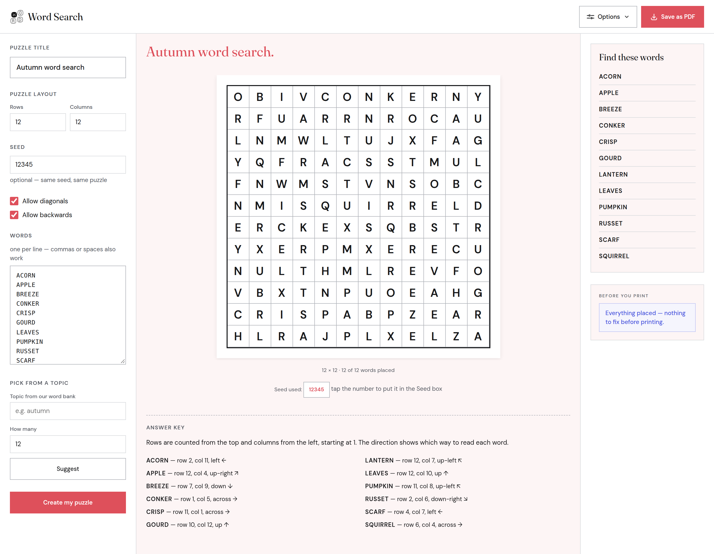

# wordsearch

Make printable word searches: give it a list of words, choose the grid size, and
print the puzzle — with an answer key on a separate page.

Two ways to use it:

- **Web app** — `web/index.html`. One self-contained page, no install, no internet needed.
- **Command line** — `wordsearch.py`. Turns a word list into a grid plus a coordinate answer key.

Opening it, printing it, and the full list of inputs are further down.

**Try it in your browser:** <https://retnoika.github.io/wordsearch/> — nothing to install, works on desktop, tablet and phone.



## Support my work
Thank you for supporting my work on Word Search.

<a href="https://www.buymeacoffee.com/retnoika"></a>

## Features

- **Words your way** — type your own (one per line; commas or spaces also work) or
  pick them from the built-in offline word bank: 39 topics with about 700 words
  between them — autumn, tea, snail mail, garden, seeds, food, flowers, trees,
  mushrooms, zodiac and two further astrology sets, and more. Topics answer to
  synonyms too, so "fall" finds autumn.
- **Grid your size** — rows and columns chosen from dropdowns (5–30 each), with
  diagonals and backwards words as checkboxes.
- **Reusable seeds** — the seed is optional; the same seed with the same words
  rebuilds the identical puzzle, so you can reprint a sheet or make several
  different sheets from one word list. The app shows the seed it used, so a
  random puzzle can be reused too.
- **Answer key** — row, column and direction for every placed word; printing
  puts it on its own page.
- **Nothing dropped silently** — in the app, words that do not fit are reported
  on screen, and accidental extra spellings created by the random filler
  letters are flagged.
- **Print-ready** — a composed A4 sheet in exactly two pages: the puzzle on
  page 1, the answer key on page 2, at every size from 5x5 to 30x30. An
  optional puzzle title, an optional name and date line, and your last inputs
  are remembered.
- **One file, no strings** — the page itself is a single self-contained HTML
  file with all CSS and JavaScript inline: no install, no build step, no
  network. The bundled Fraunces and DM Sans fonts sit next to it in
  `web/assets/fonts/`; copy the HTML on its own and it still works — it just
  falls back to your system's serif and sans. It works offline, on desktop,
  tablet and phone. A small command-line script (`wordsearch.py`) does the same
  job in the terminal.

## Usage

```bash
python3 wordsearch.py --size 12 MOON LANTERN STAMP LETTER
python3 wordsearch.py --size 12 --diagonal --backwards < words.txt   # one word per line
python3 wordsearch.py --size 10 --seed 4 --diagonal --backwards LANTERN STAMP LETTER
```

- `--size` grid size (default 12)
- `--seed` reproducible grids — same seed and word list always give the same puzzle
- `--diagonal` adds both diagonal directions
- `--backwards` adds reversed placements
- `--words` from argv, or one per line on stdin

Output: letters grid, then a coordinate list per word (the answer key).

## Known limits

- Words must fit inside the grid (`len(word) <= size`) or they are skipped silently;
  the final line reports `placed/total` so check it.
- Filler letters are random uppercase — later vowels may accidentally complete a word.
- Plain-text output only — for a printable page, use the web app below.

## What it deliberately doesn't do

- **No online word lookup and no API keys.** The app never calls a service to invent
  words and holds no credentials, so there is nothing to configure, nothing to pay
  for, and nothing to break when a third party changes. The built-in word bank is a
  starter set — type your own words for anything it does not cover.
- **No accounts, no tracking, no telemetry.** Nothing you type leaves your browser;
  there is no analytics script, no cookie, and no cookie banner because there is
  nothing to consent to.
- **No server and no dependencies.** The web app is one HTML file plus its
  bundled fonts, running entirely offline. Copy it anywhere, keep it forever.

## Web app

`web/index.html` is a single self-contained page — all CSS and JavaScript are
inline, with no frameworks, no CDN, and no build step. Double-click it (or open
it in any browser); it works straight from disk and offline. It follows the same
placement rules as the CLI: longest word first, up to 500 placement attempts per
word, a cell may be shared only when the letters match, and leftover cells get
random letters.

Inputs (all in the left rail; the puzzle appears in the centre and the word
list plus any warnings in the right rail):

- **Words** — one per line; commas or spaces also work. Everything is
  uppercased, stripped of non-letters, and de-duplicated.
- **Pick from a topic** — type a theme (e.g. autumn, tea) or any single word from the built-in offline word bank (e.g. pumpkin) and tick the suggestions, which appear under the input; coverage is limited to the bundled topics.
- **Puzzle Layout** (Rows / Columns) — grid size chosen from dropdowns, 5–30 each (default 12 × 12).
- **Print a name and date line** — a checkbox under Puzzle Title, off by
  default. When ticked, the printed sheet carries `Name ____` and `Date ____`
  blanks in its header for classroom use. It affects printing only, and it is
  remembered with the other inputs.
- **Allow diagonals / Allow backwards** — checkboxes; which directions words may run.
- **Seed** — optional. The same seed with the same inputs always rebuilds the
  identical puzzle; leave it blank for a fresh puzzle on every click.
- **Create my puzzle** — builds the puzzle from whatever is in the box; it never
  regenerates while you type.
- Words that cannot be placed are listed on screen ("Not placed", right rail) with a reason,
  never silently dropped, and stray extra spellings created by the random
  letters are flagged.

The header's **Options** menu downloads the puzzle as a `.svg`, the answer key
as a `.svg` with every word outlined, or the answer key as a `.txt` — all named
after the puzzle title (`untitled-puzzle` when the title is empty) — or clears
everything (title, words, topic picks, seed, size). The `.svg` files are the
grid as vector with the letters still editable text, sized in millimetres so
they open at the printed size in a design app; in the key file the outlines sit
in one `answer-key` layer, so they can be recoloured or hidden. The seed shown
under the grid can be tapped to reuse it.

Printing (**Save as PDF**, which opens the browser's print dialog) gives a
composed A4 sheet — exactly two pages at every size from 5x5 to 30x30. Page 1
is the puzzle: a small `WORD SEARCH` eyebrow, the puzzle title, the optional
name and date line, a hairline rule, the grid centred and sized to fill the
printable width (cells up to 14 mm, so a 12 × 12 is about 168 mm wide), then
`WORDS TO FIND · n` above the word list in columns, and a footer rule reading
"Answer key on page 2". Page 2 is the answer key: `ANSWER KEY` with the puzzle
title, so a printed key identifies its puzzle; one line noting that rows count
from the top and columns from the left, both starting at 1; and the answers in
two balanced column blocks as word / position / direction. The header and
rails never print, and **Save as PDF** stays disabled until a puzzle has been
created.

## How to open it (fastest first)

**1. Straight from GitHub — nothing to install**

1. Open the repository page and click into `web/index.html`.
2. Click **Download raw file** (the download icon at the top right of the file view).
3. Double-click the downloaded `index.html` in your Downloads folder — it opens in your browser. Bookmark it or drag it to the Dock. It works offline from then on.

**2. Download the whole repo as a ZIP**

Green **Code** button → **Download ZIP**, then unzip and open `web/index.html`.

**3. With git**

```bash
git clone git@github.com:retnoika/wordsearch.git            # SSH, if your key is set up
# or clone over HTTPS — if the repository is private, GitHub asks for your
# username plus a personal access token instead of a password
cd wordsearch
git pull                     # later, to pick up changes
open web/index.html          # macOS; use xdg-open on Linux
```

**Printing:** with a puzzle on screen press **Save as PDF** — A4 paper, exactly
two pages: page 1 is the puzzle (header, grid, word list, footer), page 2 is
the answer key, carrying the puzzle title so the key identifies its puzzle.

## Credits

Fraunces and DM Sans are bundled under the SIL Open Font License; the licence
text is vendored at `web/assets/fonts/OFL.txt`. The interface icons are inline
[Tabler](https://tabler.io/icons) icons, MIT licensed.

The app icon is "Word game" by
[Graphics Hill](https://www.flaticon.com/authors/graphics-hill) on
[Flaticon](https://www.flaticon.com/free-icon/word-game_18410346), used under
Flaticon's free licence, which requires this attribution.
